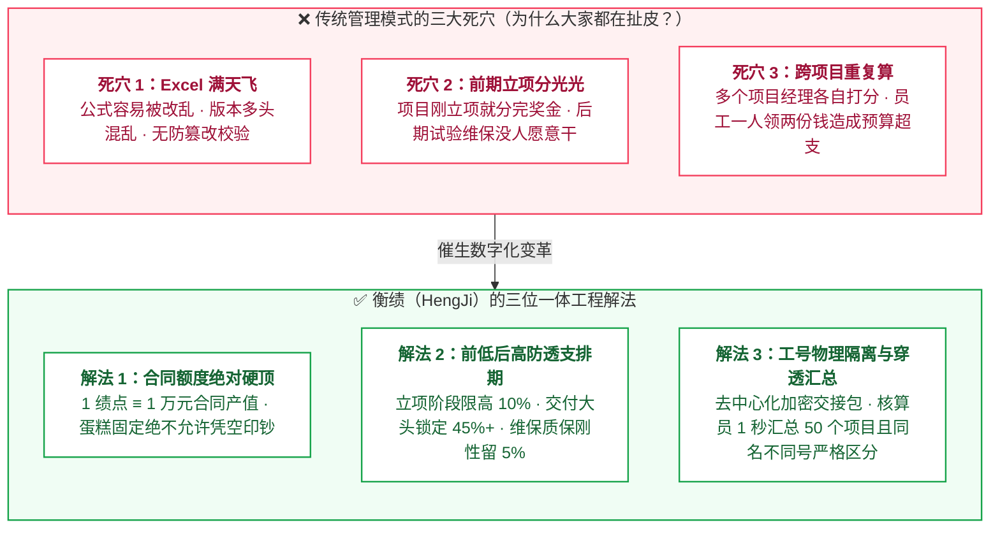
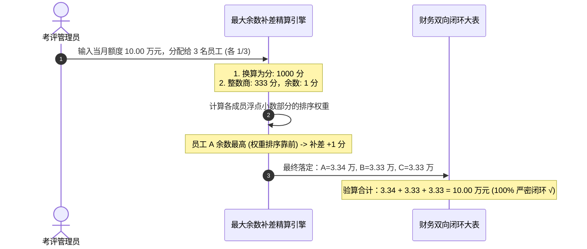
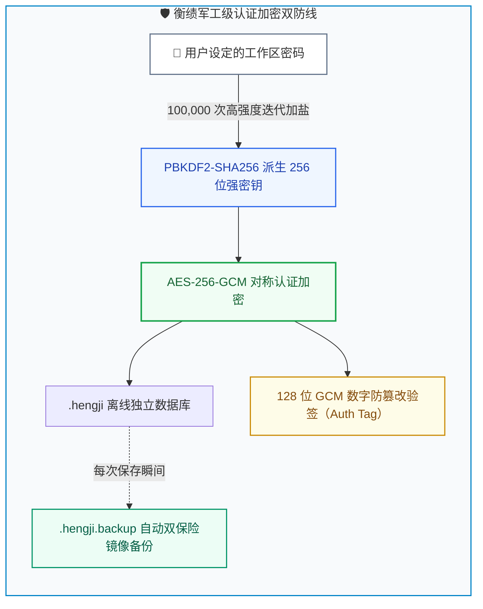
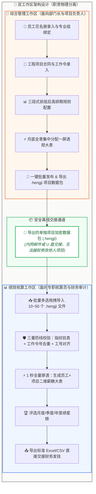
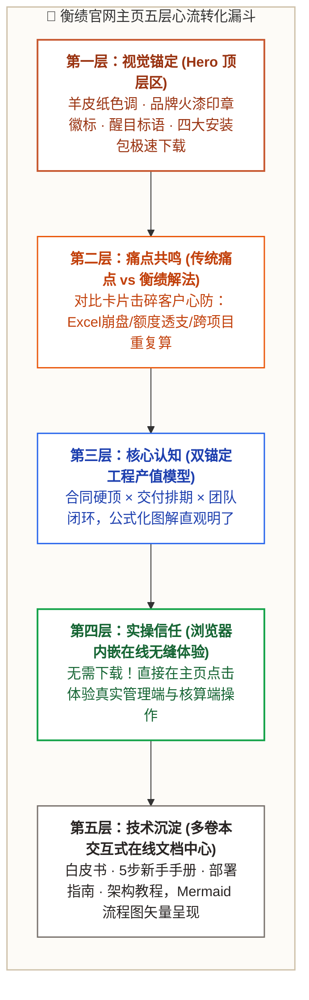

# 衡绩设计教程：从零构思到工业级离线绩效考核软件与官方网站全景实战指南

> **适用读者**：零基础或初中级前端/全栈开发者、高校计算机与软件工程学生、企业信息化产品经理及技术架构师。  
> **文档特点**：通俗易懂、多形象类比、思路层层递进、图文并茂（内含丰富标准 Mermaid 架构图），带你手把手拆解并实现一款工业级纯本地离线加密绩效量化系统（衡绩 HengJi）及其高端羊皮纸风格官方主页。

---

## 🧭 导读：写给新手的一封信

如果你刚学完 HTML、CSS、JavaScript，或者正在接触 React 和 Electron，面对复杂的企业管理软件，可能会觉得它是一座“高不可攀的黑盒”：
- 几百万、几千万的科研合同产值，到底是怎么拆分到每个员工头上的？
- 为什么涉密军工和科研院所坚决不用企微、钉钉或云端 SaaS，非要用“拔掉网线也能跑”的单机桌面软件？
- 为什么大家都讨厌 Excel 算绩效，但市面上又找不到称手的工具？
- 怎样才能做出一个像“羊皮纸古籍”一样既有历史厚重感、又有现代科技感的官网主页？

**别担心！本教程不堆砌晦涩的学术名词，而是用大白话和生活中的生动比喻**，带你从“一张白纸的构思”开始，一步一步敲开软件设计的每一扇大门。读完这篇教程，你不仅能透彻理解衡绩软件的每一个设计细节，更能独立写出属于你自己的工业级系统！

---

## 第一章：痛点拆解与商业架构——我们为什么要做这款软件？



### 1.1 形象类比：十位大厨与五桌大席的“分钱困局”
想象一下，你开了一家大型国宴餐厅，接了 5 桌长达半年才能吃完的顶级国宴（相当于 5 个长期工程项目）。
- **问题一（蛋糕膨胀）**：负责凉菜、主菜、汤品、雕花的大厨各管各的，大家都觉得自己的功劳最大。月底发奖金时，各组负责人上报的金额加起来，居然达到了总营收的 **130%**！老板如果不管，餐厅当月就直接破产。
- **问题二（前紧后松与烂尾）**：做大席刚开始买菜、备料时，大家就把 80% 的服务费给瓜分了。等到几个月后菜肴上桌、客人要喝茶加水、洗碗打扫（相当于售后维保）时，大厨们兜里早已领完钱，全跑到隔壁打牌去了，根本没人愿意留在后厨擦桌子！
- **问题三（一人多领）**：张师傅既在“第一桌”切了土豆，又在“第三桌”炒了牛肉。两个桌子的领班互不通气，张师傅在两边都按全勤领钱，财务月底做总账时彻底抓狂。

### 1.2 衡绩的“定海神针”设计法则
衡绩软件的设计哲学非常朴素，只有三条：
1. **合同额度就是绝对硬顶（1 绩点 ≡ 1 万元产值）**：
   项目合同是 100 万元，那这个项目全生命周期能够分配的总绩点就只能精确等于 100 绩点，分毫不差，系统底层用代码焊死，任何人无法超发！
2. **三段式前低后高排期（防透支模型）**：
   立项首月最多只能分 5%~10%（前期保底）；项目攻坚交付月释放 45%+（大头激励）；项目结束最后一个月必须刚性锁定 5% 作为维保质保金。谁也别想提前把未来的钱分光！
3. **唯一的身份证号（工号）全局锚定**：
   不管项目经理换谁、文件怎么发，张三在系统里永远只有唯一的工号 `EMP001`。跨项目汇总时，无论从多少个加密文件里搜集数据，都按工号自动归并到同一行。

---

## 第二章：核心精算算法与安全基石——数学与密码学的严密底盘

### 2.1 为什么标准 JavaScript 的数学运算在财务面前是“灾难”？
新手在刚学前端时，通常直接用浮点数运算：
```javascript
// 你以为的结果：0.3
console.log(0.1 + 0.2); 
// 浏览器实际打印：0.30000000000000004
```
> **形象类比（超市剁肉末）**：  
> 这就像你去菜市场买肉，摊主的称每次称重都会平白无故多出来几粒肉末。平时称一斤肉没感觉，但如果你给几百个员工发工资、核算上千万的科研经费，累加起来账目就会多出几块几毛，财务审计会一枪毙掉你的软件！

#### 衡绩的工程解法：BigInt 整数分位（Cents）转换
我们在底层**完全禁止使用浮点数保存金额**，而是把所有人民币的“万元”全部乘上 1,000,000 换算成“分”，以大整数 `BigInt` 进行绝对精确的加减乘除运算：
```typescript
// 1.25 万元 = 12,500.00 元 = 1,250,000 分
const amountInCents = 1250000n; 
```

---

### 2.2 最大余数法（Largest Remainder Method）的通俗精解
当 3 个人平分 10 块钱时：
- $10 \div 3 = 3.333333...$ 元
- 如果每个人都给 3.33 元，总和就是 $3.33 \times 3 = 9.99$ 元。那剩下的 **1 分钱（0.01元）** 该归谁？



衡绩底层代码严格实现了**最大余数补差法**：
1. 先计算每个人按整数分值能分到多少；
2. 算出被截断的余数，按余数从大到小对成员进行降序排列；
3. 将未分完的零头“1分钱”，依次优先补给排序最靠前的成员；
4. 最终使得所有成员的分配金额相加，**100% 严密闭合等于当月可用总预算**！

---

### 2.3 为什么坚决不做云端 SaaS？军工级离线加密机制

很多新手会问：“现在不都是把数据存到云端 MySQL、走 REST API 吗？为什么衡绩非要做纯本地 `.hengji` 文件？”
- **涉密红线**：航空航天、舰船雷达、尖端芯片等科研团队的研发人员名册与合同细目属于国家和企业核心机密，机房甚至完全没有外网网线。任何可能将数据传到公网云端服务器的软件，连单位大门都进不去！
- **不留痕迹**：不能把数据偷偷藏在 `C:\Users\AppData` 等隐藏目录，一旦电脑崩溃系统重装就会彻底丢失。必须让用户自己挑选保存在哪（比如 `D:\科研项目绩效\`）。



- **类比说明**：
  - **PBKDF2-SHA256**：就像银行金库的转盘锁，普通锁转 1 圈就开了，而这个锁必须极度精确地旋转 10 万圈！即使黑客用超级计算机暴力破解，也要算上一百万年。
  - **AES-256-GCM**：不仅锁上金库，还在门缝处贴上了一张带有激光全息防伪防撬标记的**数字蜡封（Auth Tag）**。如果有人用十六进制编辑器偷偷改了文件里的 1 个字符，解密时蜡封瞬间破碎，系统立刻报警拒载！
  - **.hengji.backup 镜像灾备**：每次保存前，自动在同目录下生成一份 `.backup` 副本，哪怕突然停电断电，也绝不丢数据。

---

## 第三章：桌面端软件系统设计与实现——从技术选型到双工作区落地

### 3.1 极简轻量的无数据库（Zero-DB）架构
新手做项目往往习惯在本地装个 SQLite 或 NeDB，但这样会带来安装包体积膨胀、SQL 注入、本地驱动兼容性等一系列麻烦。
衡绩采用 **“纯单向状态机（Redux-like State）+ 内存操作 + 原子写入加密文件”** 的极简架构：
- 内存中持有一个完备的 TypeScript 状态树 `AppState`。
- 所有的“导入员工”、“新建合同”、“月度分配”、“发布”，都是对状态树的纯函数计算。
- 点击保存时，直接将内存状态序列化为 JSON，进行 AES-256-GCM 加密，原子写入目标磁盘文件。



### 3.2 交互设计的“魔鬼细节”：为什么坚决不做弹窗？
很多软件做考评分配时，点一个项目弹出一个小弹窗，改完保存关掉，再点下一个……
如果一个部门有 15 个项目在研，管理员每个月要点开、关闭 15 次弹窗，眼睛看花、手点酸，还看不到全局的总人数和总预算！
衡绩采用 **“月度分配全项目当月集中大表”**：
- **一屏全景平铺**：所有在研项目并排铺开，谁分了多少、总和是不是 100%，一眼看穿；
- **智能套用规划**：点击【⚡ 套用当月规划】，系统自动根据年初定好的排期把可用额度和基准名单拉出来；
- **微调比例即时刷新**：改动某个人的比例，底下总计自动变动；如果没满 100% 亮黄灯警告，超出了亮红灯阻断，精确满 100% 亮绿灯对勾；
- **一键批量盖章发布**：检查无误后，点击【一键批量发布】，所有项目同时加盖数字指纹锁定，杜绝后续暗中修改。

---

## 第四章：官方网站与视觉体验设计——羊皮纸美学与高转化主页

很多开发者做出来的官网像“模板套出来的后台”，蓝底白字、冷冰冰毫无质感。
衡绩作为一款面向尖端工程、国家科研团队的专业工具，官网设计必须传递出 **“权威、庄重、可靠、历久弥新”** 的信任感。



### 4.1 羊皮纸暖金与工业陶土红配色哲学
我们没有使用满大街的科技蓝（#0066ff），而是定义了一套专有色彩体系（Parchment Theme）：
- **背景底色（羊皮纸暖白 `#faf7f0`）**：模拟古籍羊皮纸的柔和自然色泽，护眼舒适，象征严肃的契约与历史档案的厚重感；
- **强调主色（工业陶土红 `#c85a32`）**：源自中国传统的火漆印章与工业锻造的炉火，象征“盖印生效、刚性锁定、不可篡改”；
- **辅助点缀（翡翠绿 `#10b981` 与 藏青蓝 `#1e40af`）**：用于表示校验通过（绿色）和专业组别（蓝色），整体视觉高级、克制、优雅。

### 4.2 零门槛在线体验区的设计秘诀
想要让用户相信你的软件好用，最有效的方法不是写一万字吹嘘，而是**把软件直接搬到网页里让他点一点**！
我们在官网主页中，通过 React 组件直接将客户端的核心 View 移植为只读/交互演示模式：
- 访客点击【🏢 体验综合管理工作区】，就能看到真实的雷达、芯片项目的月度分配表，甚至可以动手改改比例感受最大余数补差；
- 访客点击【📊 体验专职核算工作区】，就能一键点击“自动归集”，亲眼看到 3 个项目的数据包如何在 1 秒钟内合成一张清晰的汇总报表！

---

## 第五章：工程化打包编译与多渠道发布——让你的作品真正触达用户

写完代码只是完成了软件生命周期的 50%，剩下的 50% 是如何稳定、无痛地交到成千上万的用户手中。

```mermaid
flowchart LR
    Code["💻 本地 Git 源码 (main)"]
    --> Test["🧪 全自动单元测试 (npm test)<br/><i>(46项精算与安全测试 100% 通过)</i>"]
    --> BuildWeb["📦 前端 Bundle 生产构建 (Vite)"]
    
    BuildWeb --> ElectronBuild["🔨 electron-builder 多格式编译"]
    BuildWeb --> PagesBuild["🌐 官网静态站构建 (带防缓存哈希)"]

    subgraph Packages["四大官方桌面安装包"]
        P1["hengji.msi (企业域静默安装)"]
        P2["hengji.exe (经典安装向导)"]
        P3["hengji-portable.exe (单文件便携版)"]
        P4["hengji.zip (免安装绿色包)"]
    end

    ElectronBuild --> Packages
    Packages --> GHReleases["🚀 发布至 GitHub Releases (带 SHA-256 校验和)"]
    PagesBuild --> GHPages["🌍 部署至 GitHub Pages 静态网站"]

    style Code fill:#f8fafc,stroke:#64748b,stroke-width:1.5px
    style Test fill:#eff6ff,stroke:#2563eb,stroke-width:1.5px,color:#1e40af
    style BuildWeb fill:#fefce8,stroke:#ca8a04,stroke-width:1.5px,color:#854d0e
    style ElectronBuild fill:#fff7ed,stroke:#ea580c,stroke-width:1.5px,color:#9a3412
    style PagesBuild fill:#fdf4ff,stroke:#a855f7,stroke-width:1.5px,color:#7e22ce
    style Packages fill:#f0fdf4,stroke:#16a34a,stroke-width:1.5px
    style GHReleases fill:#dcfce7,stroke:#16a34a,stroke-width:2px,color:#15803d
    style GHPages fill:#dbeafe,stroke:#2563eb,stroke-width:2px,color:#1d4ed8
```



### 5.1 四大官方分发格式选型指南
为什么同一个软件要提供 4 种不同的下载文件？
1. **MSI（企业级安装包）**：大型企业网管可以通过 Active Directory 域策略（GPO）一行命令静默推送到 500 台员工电脑上，员工开机即用，无需手动点击下一步；
2. **EXE（NSIS 安装向导版）**：普通用户最熟悉的安装方式，双击一路点击“下一步”，自动在桌面生成精美快捷方式；
3. **Portable（单文件便携版）**：受限办公电脑（没有管理员提权密码），或者装在 U 盘里插到哪台电脑就在哪台电脑运行，拔掉 U 盘不留任何系统垃圾；
4. **ZIP（绿色压缩包）**：不想安装、直接解压到 D 盘就能用，便于内网归档。

### 5.2 GitHub Pages 静态站点部署防缓存秘诀
在部署静态网页时，新手最常遇到的问题是：“我明明更新了网页，但用户刷新还是看到老页面！”
衡绩在 `scripts/deploy-pages.mjs` 中采用了**基于时间戳的内容指纹哈希（Content Hash）**：
- 每次编译时，自动为 CSS 和 JS 生成独一无二的文件名（如 `desktop-desktop-mvo0y99m.js`）；
- 在 HTML 头部注入强缓存失效头（`Cache-Control: no-cache, no-store, must-revalidate`）；
- 通过自动化脚本强制推送到 `gh-pages` 分支，实现 10 秒极速部署且用户刷新即获最新版本！

---

## 结语：给新手的全栈工程师心法

回顾衡绩的完整研发历程，你会发现：
1. **写软件最核心的不是花哨的代码，而是对真实业务痛点的敬畏**。如果你不知道科研人员和财务为什么在为 Excel 头疼，再先进的技术也只能写出自嗨的玩具；
2. **数学严谨性决定了一款管理软件的生命上限**。用 BigInt 还是 Number、用最大余数还是四舍五入，差的看似只有一分钱，但背后是工程伦理与底线思维；
3. **视觉美学是产品的灵魂外化**。羊皮纸色调、圆润的火漆印章、严丝合缝的矢量 SVG 流程图，能够瞬间拉开你的作品与地摊模板的档次差距。

愿这篇教程成为你全栈开发之旅上的一盏明灯。打开代码编辑器，现在就去构建属于你的世界吧！
